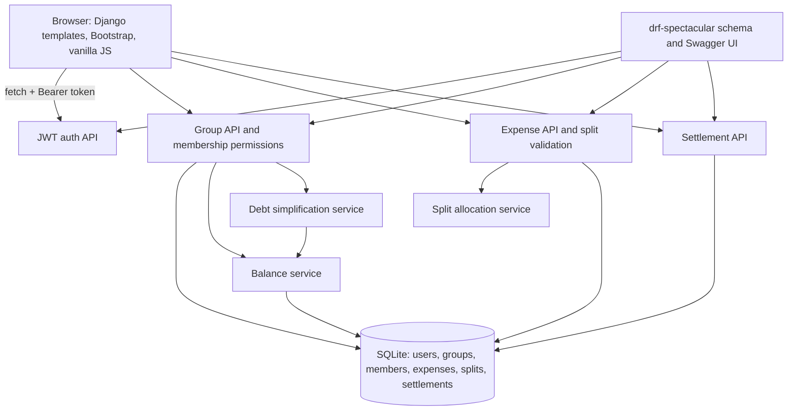

# SplitSmart

Repository: <https://github.com/ritthik7877/Expense-Splitter-with-Debt-Simplification>

SplitSmart is a Django and Django REST Framework expense-sharing app. It supports
equal, exact, and percentage splits, JWT authentication, member-only group
access, balance tracking, and simplified payment plans.

## System architecture

The application is a Django monolith organized into small domain apps. The
template frontend and REST API share one Django server and SQLite database.



### Application components

| Component | Responsibility |
| --- | --- |
| `splitsmart/` | Django settings, root URL configuration, ASGI, and WSGI entry points. |
| `users/` | Custom user model, password-validated registration, JWT login, and `seed_demo` command. |
| `groups/` | Groups, through-model membership, group APIs, membership permissions, and group-level balance/settlement-plan endpoints. |
| `expenses/` | Expense and split models, expense API, exact/equal/percentage share allocation, balance aggregation, and debt simplification services. |
| `settlements/` | Recorded payments between group members. |
| `templates/`, `static/` | Login/registration, group dashboard and detail UI, and fetch-based browser interactions. |
| `*/migrations/` | Database schema history for each Django app. |

### Data relationships and money rules

```text
User 1 ─── * Group (created_by)
Group * ─── * User, through GroupMember
Group 1 ─── * Expense 1 ─── * ExpenseSplit * ─── 1 User
Group 1 ─── * Settlement (from_user → to_user)
```

Every stored monetary amount is a `DecimalField(max_digits=10,
decimal_places=2)` and service calculations use Python `Decimal`, never floats.
An expense creates one `ExpenseSplit` for each included member; split amounts
must sum exactly to the expense total. Equal splits allocate leftover cents in
member order. Exact shares must add up to the total, while percentages must add
up to 100 and their calculated cent shares are adjusted to sum exactly.

Only authenticated group members can read group details, expenses, balances,
or settlement plans, or add members and record payments. Group listings are
filtered to the requesting user. Registration and login are the only
unauthenticated API operations.

### Request and business process

1. **Register and sign in:** The browser posts account details to
   `/api/auth/register/`, then username/password to `/api/auth/login/`. The
   browser keeps the returned access token in `localStorage` and sends it as a
   Bearer token on API calls.
2. **Create a group:** `POST /api/groups/` creates the group and automatically
   makes its creator a member. Other users can be included using `member_ids`
   or added by a current member through `/api/groups/{id}/add-member/`.
3. **Record an expense:** `POST /api/groups/{id}/expenses/` validates that the
   payer and every split participant belong to the group. The split service
   validates the requested split type, computes cent-precision shares, and
   stores the expense and all shares in one database transaction.
4. **Calculate balances:** For each member, the balance service computes
   `amounts paid - expense shares owed + settlements sent - settlements
   received`. Positive amounts are owed back to the member; negative amounts
   are owed by the member.
5. **Simplify debts:** `GET /api/groups/{id}/simplify/` passes net balances to
   the pure `expenses.services.simplify.simplify_debts` function. Two heaps
   match the largest debtor and creditor, repeatedly transferring the smaller
   outstanding amount. Each transfer eliminates at least one outstanding
   balance, producing a minimum-transaction plan in O(n log n) time for n
   members. Cent rounding is reconciled deterministically to preserve a zero
   balance total.
6. **Record payment:** A member posts the payer, recipient, and amount to
   `/api/groups/{id}/settle/`. The settlement is stored and included in future
   balance and plan calculations.

### Runtime and integration boundaries

The browser uses server-rendered Django templates with Bootstrap from a CDN;
JavaScript handles API requests and renders data. Django REST Framework
provides API serializers, authentication, and status-code handling.
drf-spectacular exposes the OpenAPI schema at `/api/schema/` and interactive
Swagger documentation at `/api/docs/`. SQLite is the local default, and
Docker Compose mounts a named data volume for the database.

## Requirements and local setup

Python 3.11 or newer is required. The following commands use PowerShell on
Windows and select the installed Python 3 interpreter; activate the virtual
environment before running Django commands.

```powershell
py -3 -m venv .venv
.\.venv\Scripts\python.exe -m pip install -r requirements.txt
.\.venv\Scripts\Activate.ps1
python manage.py makemigrations
python manage.py migrate
python manage.py seed_demo
python manage.py runserver
```

Open <http://127.0.0.1:8000/> for the web app and
<http://127.0.0.1:8000/api/docs/> for Swagger. Demo users `alice`, `bob`, and
`carol` have password `SplitSmart123!`. Set a private `DJANGO_SECRET_KEY` and
`DJANGO_DEBUG=False` for deployments; `.env.example` lists available settings.

To run tests (and see coverage for the business services):

```powershell
pytest --cov=expenses.services --cov-report=term-missing
```

The test suite includes expense-splitting and debt-simplification unit tests,
plus API tests for authentication, membership access, and each split type.

## API

Except for registration and login, API endpoints require
`Authorization: Bearer <access-token>`. Login returns access and refresh JWTs.
Use `POST /api/auth/register/`, then `POST /api/auth/login/` with username and
password to obtain tokens.

```bash
# Create a group
curl -X POST http://127.0.0.1:8000/api/groups/ \
  -H "Authorization: Bearer $TOKEN" -H "Content-Type: application/json" \
  -d '{"name":"Weekend trip"}'

# Add an expense with equal shares (EXACT uses amount entries; PERCENTAGE uses
# percentage entries, both keyed by the group's member user IDs)
curl -X POST http://127.0.0.1:8000/api/groups/1/expenses/ \
  -H "Authorization: Bearer $TOKEN" -H "Content-Type: application/json" \
  -d '{"description":"Dinner","amount":"90.00","paid_by_id":1,"split_type":"EQUAL"}'

# View balances and the simplified payment plan
curl http://127.0.0.1:8000/api/groups/1/balances/ \
  -H "Authorization: Bearer $TOKEN"
curl http://127.0.0.1:8000/api/groups/1/simplify/ \
  -H "Authorization: Bearer $TOKEN"
```

Main routes: `GET/POST /api/groups/`, `GET /api/groups/{id}/`,
`POST /api/groups/{id}/add-member/`, `GET/POST
/api/groups/{id}/expenses/`, `GET /api/groups/{id}/balances/`,
`GET /api/groups/{id}/simplify/`, and
`POST /api/groups/{id}/settle/`. New groups include their creator; additional
members can be passed as `member_ids` during group creation or added with
`{"user_id": 2}`. Settlements accept `from_user_id`, `to_user_id`, and a
positive decimal `amount`.

## Debt simplification

Balances equal expenses paid minus expense shares owed, adjusted for recorded
settlements. The service uses two max-heaps to repeatedly match the largest
debtor with the largest creditor. Transfers are made for the smaller of those
two balances, and any remainder is reinserted into its heap. Heap operations
make the matching step O(n log n) for n users. Money values use `Decimal` and
are rounded to cents; residual rounding is corrected deterministically so the
resulting balance total remains exactly 0.00.

## Docker

```bash
docker compose up --build
```

The app is available at <http://127.0.0.1:8000/>. SQLite data persists in the
`splitsmart-data` Docker volume.

## License

This project is released under the MIT License. See [LICENSE](./LICENSE).
